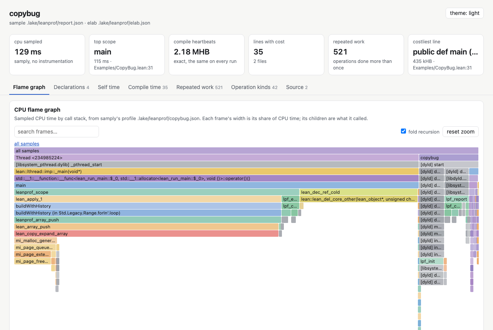

# leanprof

[Website and documentation](https://unbalancedparentheses.github.io/leanprof)

> **Find out why your Lean 4 code is slow, and how to fix it.**
>
> leanprof profiles Lean programs and proofs without changing your project. It
> counts what makes Lean slow that no other profiler sees (copies of shared
> arrays and strings, allocations, failed reuse, the unfolds and instance
> searches behind compile time), names the line and the cause, and prints the
> fix. In CI it fails a pull request on "+1 copy" and says what made it slower.

- A compiler written in Lean: **22% faster**, from changes leanprof's loop
  found and kept ([merged](docs/case-studies/autoresearch-lean-compiler-backend.md)).
- Three of Mathlib's slowest files: **46–69% fewer heartbeats**, same terms
  ([case study](docs/case-studies/mathlib.md)).
- A **2.4% slowdown caught 4 times in 5** where LeanBench caught none
  ([comparison](docs/case-studies/leanbench.md)).

Why copies: `arr.push x` is fast only when nothing else refers to `arr`; if
something does, Lean silently copies the whole array first. One stray
reference turns a linear loop quadratic, and nothing in your code, your
types, or a normal profiler tells you. leanprof shows each one: the line, how
many, how many bytes, how much time, why the value was shared, and the fix.

## Why leanprof, and not the alternatives

- **It sees the costs that are specific to Lean.** Copies of shared values,
  allocations, failed reuse and closure calls, counted exactly per source
  line, with the cause read from the compiler's IR and the fix written with
  your own names; `leanprof fix` applies the mechanical ones and keeps an
  edit only when the output, the tests and the measurements agree. samply,
  perf, [LeanProfiler](https://github.com/lean-dojo/LeanProfiler),
  [LeanBench](https://github.com/alok/LeanBench) and
  [lean-source-profiler](https://github.com/Vilin97/lean-source-profiler)
  report time only.
- **It says why a pull request got slower.** Copies, allocations and calls are
  exact counts, so CI can fail on "+1 copy" without noise; the comment names
  the declaration that got more expensive and the unfold, instance search,
  `simp` lemma or `grind` theorem behind it. Against LeanBench it caught a
  2.4% slowdown 4 times in 5 (LeanBench at its 5% threshold: 0 in 5), with no
  false alarm in 20 unchanged runs ([case study](docs/case-studies/leanbench.md)).
- **Its probes cost nanoseconds, not microseconds.** About 5–7 ns per scope on
  the Mac and 23 ns on Linux, constant and subtracted; LeanProfiler's span
  costs 4.7 µs at first and 96 µs once its events accumulate. With probes
  placed where LeanProfiler's spans are, leanprof is as accurate or better on
  every benchmark workload ([results](bench/RESULTS.md)).
- **Nothing to change in your project.** It profiles any Lake project from
  outside: every function with `--auto`, dependencies included, and puts your
  normal build back afterwards. LeanProfiler and LeanBench need code in
  your project.
- **Sampling that knows Lean.** It runs samply and adds Lean names, file:line,
  the runtime's share (allocation, freeing, copying) and which of your
  functions library code ran under. On Linux it rebuilds the stacks perf
  cuts short: deep recursion 1.2 points off its true share, against samply's
  14.8.
- **Run time and compile time in one tool.** Compile cost per declaration,
  term and tactic in exact heartbeats, the definitions unfolded behind it,
  repeated work, and a project-to-tactic [viewer](docs/profiles/README.md);
  full profiles cost 1.3–1.9 times less per file than lean-source-profiler's
  detailed mode.
- **Built for agents.** An MCP server, ranked findings as JSON, paired
  verdicts, and an [autoresearch loop](docs/case-studies/autoresearch-lean-compiler-backend.md)
  that made a compiler written in Lean 22% faster, merged after review.

**Where it is behind:** LeanBench reaches a time verdict faster (0.74 s
against 2.9–7.1 s); lean-source-profiler publishes all of Mathlib, leanprof
Batteries and 40 Mathlib modules; exact compile-time ranges need the Lean
leanprof was built with; tiny `profile!` scopes are timed less accurately
than by sampling. Details and every number in
[where leanprof wins, and where it does not](#where-leanprof-wins-and-where-it-does-not).

## What it found in real code

All profiled from outside, without changing the projects:

- **[Mathlib](docs/case-studies/mathlib.md)**: among its 20 slowest files,
  two small kinds of change cut compile heartbeats by 55%, 69% and 46% in
  three of them (`Formula.lean` 8.2 s → 2.6 s, `FourierTransform.lean` about
  10 s → 3.5 s, `LpSpace.lean` 3.6 s → 2.1 s), producing the same terms. The patches are [ready](docs/upstream/mathlib/), not
  sent.
- **[Lake and the language server](docs/case-studies/lake-and-server.md)**:
  seven candidate Lean patches; four of them make a no-op `lake build` of a
  Mathlib project 19% faster (1.58 s → 1.29 s), another cuts the server's
  CPU by 13%. Not sent, and not yet run through Lean's own test suite.
- **[lean-compiler-backend](docs/case-studies/lean-compiler-backend.md)**, a
  compiler written in Lean: three fixes found with leanprof, now on its
  `main`, cut the allocations needed to compile zlib from 11.95M to 7.72M
  (−35%) with byte-identical output on 160 input and option combinations.
  `explain` printed the `CFG.build` fix (121,054 copies). Wall time did not
  measurably change: fewer allocations is not always a faster program.
  Then the [autoresearch loop](docs/case-studies/autoresearch-lean-compiler-backend.md)
  found that each function was validated about ten times on its way through
  the compiler, each time rebuilding its CFG. Its 12 kept changes initially cut
  measured wall time by 24% and allocations by another 16%. After review and a
  validation correction, the series is merged: [fresh ordinary builds](research/lcb/results/README.md)
  confirm **22% less median wall time**, with 540 matching output/diagnostic cases.
- **[doc-gen4](docs/case-studies/doc-gen4.md)**: one SQL query that grows with
  the square of a module's declarations takes two thirds of the HTML pass.
- **[verso](docs/case-studies/verso.md)**: about 23% of rendering is
  pretty-printing JSON only to compare index entries.
- **[lean-regex](docs/case-studies/lean-regex.md)**: 15 allocations per input
  character in the ε-closure; 13.7M closure calls through an unspecialized
  function.
- **[concrete](docs/case-studies/concrete.md)** and
  **[Batteries](docs/case-studies/batteries.md)**: linear list searches are a
  quarter of concrete's self time; an iterator definition is unfolded 24,369
  times from ordinary RBTree proofs.
- **[Dogfooding on both compilers](docs/case-studies/dogfood-lcb-concrete.md)**:
  every command run again on lean-compiler-backend and concrete found two
  more fixes in each (paired timing: −8.2% and −19.1% on their workloads,
  same output on 540 and 6,817 cases) and seven leanprof bugs, now fixed.
- **[LeanProfiler](bench/README.md)**: why its cost per span grows with the
  number of events (its event array is copied on every span).

## Quickstart

```
curl -sSfL https://raw.githubusercontent.com/unbalancedparentheses/leanprof/main/scripts/install.sh | sh
cd your-lean-project
leanprof                             # finds what to profile, samples it, top findings and next steps
leanprof myapp -- args               # the same for one of several executables, with its arguments
leanprof run myapp -- args           # exact counts, copies, tasks
leanprof explain                     # why each copy happened, and the fix
leanprof fix --exe myapp -- args     # apply it on a branch, test, measure, commit a KEEP
leanprof elab --heartbeats Foo.lean  # what each line costs to compile
```

Your project needs no changes: leanprof compiles its runtime for your Lean
version (4.34 and later) and puts your normal build back afterwards. The
installer downloads a release for macOS (arm64, x86-64) or Linux (x86-64,
arm64), checked against `SHA256SUMS`, or builds from source, and offers to
fetch [samply](https://github.com/mstange/samply) (pinned, checksum-verified)
for sampling; `leanprof doctor` says what is missing. Windows is not supported (WSL 2
works). To mark code with `profile!`, assert in tests that code does not copy
or allocate, or use `#leanprof` in the editor, add the dependency:

```lean
require leanprof from git "https://github.com/unbalancedparentheses/leanprof" @ "main"
```

The [getting started guide](docs/guide/getting-started.md) walks through it.

## What it shows

```
$ leanprof run copybug

     calls      total       self  %wall       mean        p50        p99  scope  (where)
         1     3.1 ms     3.1 ms  12.7%     3.1 ms     3.0 ms     3.0 ms  buildWithHistory  (Examples/CopyBug.lean:17)
     10945  36.9 µs*   36.9 µs   0.1%      41 ns    < probe     352 ns  fib  (Examples/CopyBug.lean:15)
* near the probe cost: use `leanprof sample` for this function's time

copies of non-exclusive values (each one copied the whole value; costliest first)
  copies       bytes       time   %run  %scope  kind        why            in scope           function  (where)
    2001    15.3 MiB     3.1 ms  12.5%   99.1%  Array       shared         buildWithHistory   buildWithHistory (in Std.Legacy.Range.forIn'.loop)  (Examples/CopyBug.lean:17)
```

A loop kept one extra reference to an array, so each `push` copied it: 99%
of the function's time, in a loop that looks linear. `explain` says why,
from the compiler's own output, and prints the fix with your names:

```
$ leanprof explain

buildWithHistory (in Std.Legacy.Range.forIn'.loop)  Examples/CopyBug.lean:17
  why: `acc` is stored in `history` at line 21 (`history := history.push acc`) and is updated
       afterwards at line 22 (`acc := acc.push i`): both refer to the same Array, so the Array.push
       copies it.
  fix: `acc` only grows (by `push`), so each version stored in `history` is a prefix of the final
       `acc`: store its length and rebuild version k as `acc.extract 0 history[k]!` when it is
       needed.
         history := history.push acc.size
```

It recognises five causes (an array inside an array, a map value updated and
reinserted, a value stored and then updated, a global shared by threads, a
loop over the array it updates), and each printed fix is tested to remove
the copies. `explain --json` gives the same findings, ranked by their share
of the run, to agents.

| | command |
|---|---|
| Pick the workload (the executable, the tests, or compile time), profile it, top three findings and the commands that go deeper | `leanprof` |
| CPU time per Lean declaration, no probes; flame graph with Lean names | `leanprof sample myapp` |
| Exact time and calls per function or `profile!` scope, own cost subtracted (`--auto` leaves functions too small to time untimed; `--time-tiny` counts them) | `leanprof run [--auto] myapp` |
| Copies of shared arrays and strings, with file:line, the reason and the fix | `leanprof run`, `leanprof explain` |
| Apply that fix on a new branch, test it, compare output, measure and judge it; commit only a KEEP, with the evidence | [`leanprof fix`](docs/guide/fix.md) |
| Allocations per function; failed in-place reuse; closure calls | `leanprof run --allocs --counters myapp` |
| Tasks: run time, queue wait, blocking waits; Perfetto timeline | `leanprof run --trace out.json myapp` |
| Peak memory per scope, freeing pauses; one-screen summary | `leanprof stat myapp` |
| A running program, live; the last seconds as a timeline | `leanprof top myapp`, `leanprof dump PID` |
| Compile cost per line, term and tactic (exact source ranges), repeated work, the definitions behind it, whole projects; a project view from project to tactic, compared with a base ([published profiles](docs/profiles/README.md): Batteries, Mathlib's 40 slowest modules) | `leanprof elab [--project] [--heartbeats]`, `leanprof html` |
| Regressions in CI, exact for copies, allocations, calls and heartbeats; PR comments that say why: the definitions unfolded, simp lemmas, instances and `grind` theorems that changed in each slower declaration, explain's cause per copy site | `leanprof compare`, [GitHub Action](docs/guide/ci-and-regressions.md#why-it-got-worse) |
| Keep or discard a change, with exact metrics or interleaved plain-binary timing | `leanprof measure`, `leanprof measure-pair`, `leanprof judge` |
| Profiling tools for AI agents | `leanprof mcp` |
| Everything next to the code, or in one shareable page | `#leanprof`, [VS Code](docs/guide/vscode.md), `leanprof html` |



## Where leanprof wins, and where it does not

Measured, with the method and raw numbers linked; `scripts/reproduce.sh` re-runs each claim and checks it ([how](docs/reproduce.md)). "Mac" is an Apple M5 Max
shared with other work ([results](bench/RESULTS.md)); "Linux" is a dedicated,
idle AMD Ryzen 9 7950X3D with the CPU frequency fixed ([results](bench/linux/after/RESULTS.md),
[before the Linux fixes](bench/linux/before/RESULTS.md)).

**Ahead, clearly:**

- **Copies and their causes.** No other Lean tool reports them. leanprof
  counts them exactly, names the line and the reason, and prints a fix that
  is tested to remove them.
- **Exact regression checks.** Copies, allocations and calls are the same on
  every run, and compile heartbeats nearly so (a whole project elaborated in
  parallel varied by up to 5 per million of its total between runs), so CI
  can fail on "+1 copy". Against
  [LeanBench](docs/case-studies/leanbench.md), only leanprof saw a hidden
  copy per iteration or 2,000 extra allocations (each under 1% of time).
- **Small slowdowns.** On the quiet Linux machine leanprof caught a 2%
  slowdown 5 times in 5 with no false alarm in 20 unchanged runs; LeanBench
  at a 5% threshold caught none of the 2% and 2 of 5 at 4.8%.
- **Full compile-time profiles.** Per file, a full profile (internal
  operations, the definitions behind the work, terms and tactics by range)
  costs 1.3 to 1.9 times less than lean-source-profiler's detailed mode
  ([comparison](docs/case-studies/compile-time-vs-lean-source-profiler.md),
  its latest release 0.3.0, on the shared Mac). Compact profiles cost about
  the same in both. All of Batteries took 17 s against 103–152 s, mostly
  because leanprof elaborates files in parallel and lean-source-profiler one
  at a time.
- **Overhead against LeanProfiler.** A profiled scope costs about 6–7 ns on the
  Mac (23 ns on Linux, see below) and stays constant however long the program
  runs; LeanProfiler's span grows from 4.6 µs to 88 µs as
  events accumulate (25 ns with recording off).
- **Breadth.** Run time, memory, tasks, compile time, CI, editor, HTML, live
  view and MCP in one tool that needs no change to the project.

- **Sampling deep recursion on Linux.** perf copies at most 64 KiB of a
  thread's stack per sample, so samply loses the outer frames of deep
  recursion (14.8 points off on the `rec` benchmark). `leanprof sample`
  completes those stacks from the thread's last whole one: 1.2 points.
- **Like-for-like with LeanProfiler.** With leanprof's scopes exactly where
  LeanProfiler's spans are, leanprof is as accurate or better on every
  workload on Linux (worst: 0.6 points against 0.7).

**Even, or behind:**

- **Probe cost on Linux: about 23 ns per scope** (51 ns before it read the
  CPU's counter instead of `clock_gettime`), against 6–7 ns on the Mac. Tiny
  functions still run about 18× slower under `profile!` there.
- **Time of tiny functions in the exact modes.** When a call costs about as
  much as its probes, its time can be off by half either way; such rows are
  marked `*`. `run --auto` leaves straight-line functions of a few
  operations untimed (listed in the report, with no call count;
  `--time-tiny` times and counts them), so the functions around them are
  timed without their probes: on the Mac's `tiny` workload 0.6–0.8 points
  off and 1.00× the plain time, against 4.3–5.2 points and 5.8× before
  (two interleaved pairs of suite runs, load about 5). Under `profile!` tiny
  scopes are timed on a sample of their calls, which makes the program
  faster (4.3× slower instead of 5.4×) but not more accurate: 10.3–11.2
  points off, against 8.3–9.0 before. `leanprof sample` is the tool for
  those functions.
- **Sampling** is as accurate as samply (it runs samply underneath; on the
  Mac within 0.2–3.3 points of each function's true share over four suite
  runs on 2026-10-25, samply 0.3–4.4)
  and adds Lean names, file:line and the runtime breakdown (on Linux, see
  deep recursion above).
- **`--auto` on Linux** is 2.6–3.2 points off on allocation- and copy-heavy
  workloads (6.5–8.2 before the Linux fixes; samply 0.5) and 10.4 points
  off on deep recursion (7.1 before: the shallow phases are now slightly
  over-subtracted while the deepest is still over-reported, see
  [bench/README.md](bench/README.md)): use `sample` or `profile!` there.
- **Cost per verdict.** On a shared Mac ([case study](docs/case-studies/leanbench.md#paired-timing-measure-pair-and-measure---scope),
  load 2–18) `measure-pair` gave the most reliable time verdict (0 false in
  40 unchanged sessions, a 2.4% slowdown caught 9 in 10) but took 7.1 s per
  verdict at its default 20 pairs (2.9 s at 6, which caught 2.4% less often)
  against LeanBench's 0.74 s; `measure` + `judge` takes 5.0 s and no longer
  forces a rebuild afterwards. LeanBench times the action in process; for a
  plain binary the whole-process dilution was small (10.4% read as 10.0%),
  and `measure --scope NAME` times one `profile!` scope.
- **[lean-source-profiler](https://github.com/Vilin97/lean-source-profiler)**
  publishes profiles of all of Mathlib (8,556 files); leanprof's
  [published profiles](docs/profiles/README.md) cover all of Batteries and
  only Mathlib's 40 slowest modules (16.1 G heartbeats, 8.5 minutes 4 at a
  time on the shared Mac). Both have a drill-down viewer; only
  lean-source-profiler's has timelines. The comparison above is against its latest release (0.3.0),
  whose default is the compact mode measured there; its main branch has
  since changed its dataset tooling and explorer, not re-tested here.
  leanprof's exact ranges need the Lean it was built with.

**Reviewed result, still awaiting independent replication:** the autoresearch
loop found 12 compiler optimizations in about three hours. Review caught a
missing validation check and restored it before merging. Fresh ordinary builds
then took [22% less median wall time](research/lcb/results/README.md)
(811 → 631 ms, 30 runs each, alternating order), with 540 output/diagnostic
comparisons passing and green compiler CI on three platforms. The machine was
shared; this remains one workload measured by this project, not an outside
reproduction.

## How it compares

| | leanprof | [LeanProfiler](https://github.com/lean-dojo/LeanProfiler) | [lean-source-profiler](https://github.com/Vilin97/lean-source-profiler) | samply / perf | [LeanBench](https://github.com/alok/LeanBench) |
|---|---|---|---|---|---|
| Run time | exact and sampled | manual spans | – | sampled | wall time per named benchmark: mean, stddev, percentiles |
| Overhead while recording | about 6–7 ns per scope on the Mac, 23 ns on Linux; constant, subtracted | 4.6 µs to 88 µs per span, growing with events | – | very low | none (times the plain build, two clock reads per sample) |
| Works without changing the project | ✅ | – | ✅ | ✅ | – (a dependency and a bench module) |
| First report | `leanprof` alone picks the workload and samples it: 8.6 s on a new `lake new` project, after a 4.8 s install with samply (Mac) | not measured | not measured | not measured | after adding the dependency and writing a bench module |
| Lean names and file:line | ✅ | your span names | ✅ (compile time) | mangled C names | your benchmark names |
| Copies, allocations, failed reuse, closures | ✅ | – | – | – | – |
| Why a copy happened, with a fix | ✅ from the compiler's IR, confirmed at run time | – | – | – | – |
| Peak memory per scope, freeing pauses | ✅ | – | – | – | – |
| Tasks | ✅ queue wait, blocking waits | parent links | – | threads | – |
| Compile time | per file, declaration, term and tactic (exact ranges with the Lean leanprof was built with); the definitions unfolded behind it; repeated work; whole projects; a project-to-tactic HTML view compared with a base; published Batteries and Mathlib (40 modules) profiles | – | exact term ranges, all of Mathlib published ([comparison](docs/case-studies/compile-time-vs-lean-source-profiler.md)) | – | LeanObserve (not evaluated) |
| Exact regression checks, PR comments | ✅, with the cause of each ([example](docs/guide/ci-and-regressions.md#worked-example-batteries)) | thresholded time | – | – | mean against a saved baseline, fixed threshold |
| Live view, flight recorder | ✅ `top`, `dump` | – | – | – | – |
| In the editor | run time, copies, compile time | – | compile time | – | a visualizer extension (not evaluated) |
| Seeded slowdowns caught, quiet machine ([case study](docs/case-studies/leanbench.md)) | 2%: 5/5, 5% and up: 5/5; never a false alarm in 20 | – | – | – | at a 5% threshold: 2%: 0/5, 4.8%: 2/5, 10% and up: 5/5; 0 false alarms in 20 |
| Wall time per verdict | `measure-pair` 7.1 s (20 pairs; 2.9 s at 6), `measure` + `judge` 5.0 s; Mac, shared | – | – | – | 0.74 s on the same Mac (0.6 s on Linux) |

## Documentation

- [Getting started](docs/guide/getting-started.md)
- [Run time](docs/guide/run-time.md): sampling, every function, `profile!`, tasks, timeline
- [Copies and allocations](docs/guide/copies-and-allocations.md), reuse and closures
- [Applying a fix with `leanprof fix`](docs/guide/fix.md)
- [Memory, frees and `leanprof stat`](docs/guide/memory.md)
- [Compile time](docs/guide/compile-time.md)
- [In the editor](docs/guide/editor.md), [VS Code](docs/guide/vscode.md) and [HTML report](docs/guide/html-report.md)
- [CI, regressions and autoresearch](docs/guide/ci-and-regressions.md)
- [Live view, flight recorder and MCP server](docs/guide/live.md)
- [Lean API](docs/guide/lean-api.md) and [reference](docs/guide/reference.md) (commands, environment, JSON)
- [How it works, and limits](docs/guide/how-it-works.md)
- Case studies: [Mathlib](docs/case-studies/mathlib.md), [Lake and the server](docs/case-studies/lake-and-server.md), [lean-compiler-backend](docs/case-studies/lean-compiler-backend.md), [doc-gen4](docs/case-studies/doc-gen4.md), [verso](docs/case-studies/verso.md), [lean-regex](docs/case-studies/lean-regex.md), [concrete](docs/case-studies/concrete.md), [Batteries](docs/case-studies/batteries.md), [vs lean-source-profiler](docs/case-studies/compile-time-vs-lean-source-profiler.md), [vs LeanBench](docs/case-studies/leanbench.md); [benchmarks](bench/README.md)
- [Reproducing the published numbers](docs/reproduce.md)
- [Roadmap](ROADMAP.md), [changelog](CHANGELOG.md), [ideas from other ecosystems](docs/research/other-ecosystems.md)

Status: early. Tested in CI with Lean 4.34.1, 4.35.0, the newest release
candidate and nightly, on macOS arm64 and Linux x86-64.

## Development

```
lake test                                   # tests
lake build copybug && .lake/build/bin/copybug
```

The runtime is [`c/leanprof.c`](c/leanprof.c); the Lean library is
[`Leanprof/`](Leanprof); the command line is
[`LeanprofCli.lean`](LeanprofCli.lean). MIT license.
