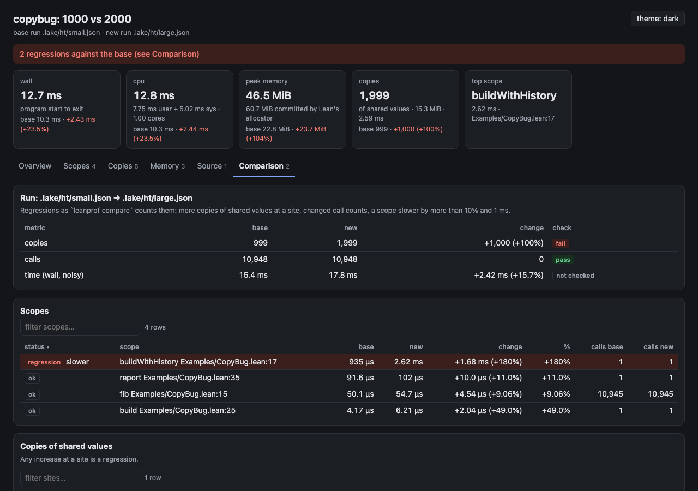

# HTML report

`leanprof html` turns reports into one HTML file you can open offline or
attach to an issue: everything (data, styles, script) is inside the file,
nothing is fetched from the network.

```
leanprof sample myapp            # or: leanprof run myapp
leanprof elab --heartbeats Main.lean
leanprof html                    # writes .lake/leanprof/report.html
open .lake/leanprof/report.html
```


```
leanprof html [-o FILE] [--trace FILE] [--profile FILE] [--threshold PCT] [--min-ms MS]
              [--context N] [--title T] [REPORT.json...]
```

Without arguments it reads `report.json`, `elab.json` and `measure.json` from
`.lake/leanprof/`, whichever exist. A page for copybug is 60 to 160 KiB.

A compile-time report of a whole project can be large: the page keeps the
2,000 costliest term and tactic ranges (`--ranges N`), and the 3,000
costliest repeated operations and definitions and the operations inside the
3,000 costliest declarations (`--keep N`; the other declarations keep their
totals), and says so where it cut. All of Batteries makes a 4.5 MiB page
with `--ranges 6000`; the [published profiles](../profiles/README.md) are
made this way.

## What the page shows

- **Project view** (for `leanprof elab` reports; the page opens on it when
  the report covers several modules): a drill-down from the project to its
  folders, a module, a declaration and a term or tactic. Each level has its
  totals split into elaboration, kernel, compiler and linters; the project
  and folder levels list their folders and modules (with each module's wall
  time and errors), a flame graph of the level and its costliest
  declarations; a module lists its declarations, its 10 costliest repeated
  operations (with what each costs in all files) and definitions behind the
  work, and its costliest terms and tactics; a declaration lists the
  operations and definitions inside it, every term and tactic that starts in
  it in source order, nested by containment, the lines Lean traced its work
  on, and its source; a term or tactic shows the ranges inside it and its
  source. The place is in the address (`#project~f=Foo/Bar.lean~d=...`), so
  the back button works and a link opens the same view. Given a base report,
  every table gains the base, the change and a status (regression, new,
  gone) by `leanprof compare`'s rules: modules by name, declarations by
  name, terms and tactics by their text, operations and definitions by name.
- **Summary**: wall and CPU time, peak memory, allocations, copies, frees,
  tasks, failed reuse and closure calls, top scope; for compile reports the
  total cost, repeated work and the costliest line. Tiles only appear for
  what the report measured.
- **Flame graph** (icicle: callers above callees). Click a frame to zoom,
  search to highlight, hover for time, share and `file:line`. Direct
  recursion is folded into one frame unless you untick it.
  - For `leanprof sample`, the sampled call stacks, read from samply's profile
    next to the report (`EXE.json` and `EXE.syms.json`, as `sample` leaves
    them; `--profile FILE` picks another). Frames are coloured by what they
    are: Lean code, the Lean runtime, copying, freeing, leanprof, system
    libraries.
  - For `leanprof run`, a report has time per scope but not who called whom.
    Pass the timeline of `leanprof run --trace trace.json` as `--trace
    trace.json` for the call tree; without it the graph shows self time per
    scope.
  - For `leanprof elab`, compile cost by file, line and phase (elaboration,
    kernel, compiler, linters).
- **Tables**, sortable by any column and filterable: scopes (or sampled
  declarations and self time per function), copies with why
  (shared, multi-threaded, persistent, tiny), their share of the run and of
  the scope's time, sorted by time, allocations with an estimated time and
  share of the run, reuse failures, closures, tasks, waits, frees, memory per
  scope, compile cost per line, repeated work, and operation kinds.
- **Source**: every `file:line` in a table is a link that opens the lines
  around it, read from the project when the page was made, with the hints
  `#leanprof` shows in the editor (`⏱` time, `≈` sampled CPU, `⚠` copies,
  `▲` allocations, `⚙` compile cost). The Source tab lists all of them per
  file. `--context N` sets how many lines around each position are kept
  (default 3).
- Times too small to measure read `< probe cost` (a scope's time after
  subtracting the probes) or `< 1 clock tick` (a copy), never 0.

## Comparing two reports

Given two reports of the same kind, the first is the base and the second the
new one:

```
leanprof html -o pr.html base.json head.json
leanprof html -o pr.html base.json head.json base-elab.json head-elab.json
```

The page shows the new report, each summary tile with its change from the
base, and a Comparison tab that applies the rules of
[`leanprof compare`](ci-and-regressions.md): more copies of shared values at
a site, more allocations in total (when both reports counted them), a
changed call count, a scope slower by more than `--threshold`
percent (default 10) and `--min-ms` (default 1), or, for `elab --heartbeats`
reports, a declaration up by more than 1% and 1,000 heartbeats. Regressions
are listed first and counted in a banner at the top. Two `measure` summaries
are compared the way `leanprof judge` does.



The page follows the system's light or dark setting; the button at the top
right switches it.

## In CI

Render the page in a job and upload it as an artifact:

```yaml
- run: |
    leanprof run --json head.json myapp
    leanprof html -o leanprof.html base.json head.json
- uses: actions/upload-artifact@v4
  with:
    name: leanprof-report
    path: leanprof.html
```

`scripts/check-html.py PAGE --expect NAME` checks a page: well-formed,
self-contained, data and script valid, at most 300 KiB, and naming `NAME`.
