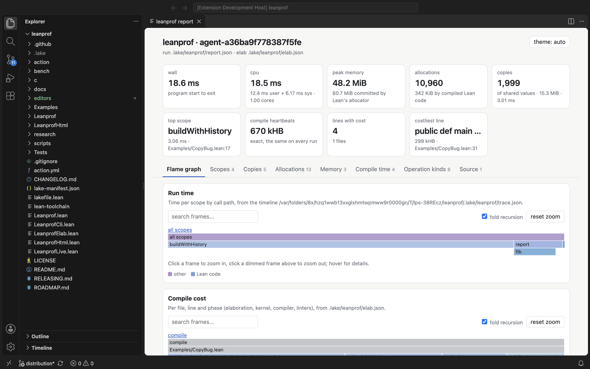
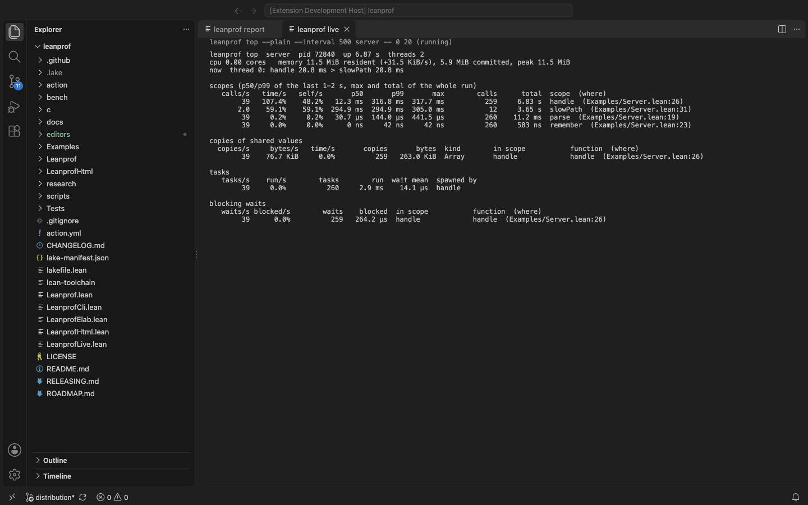
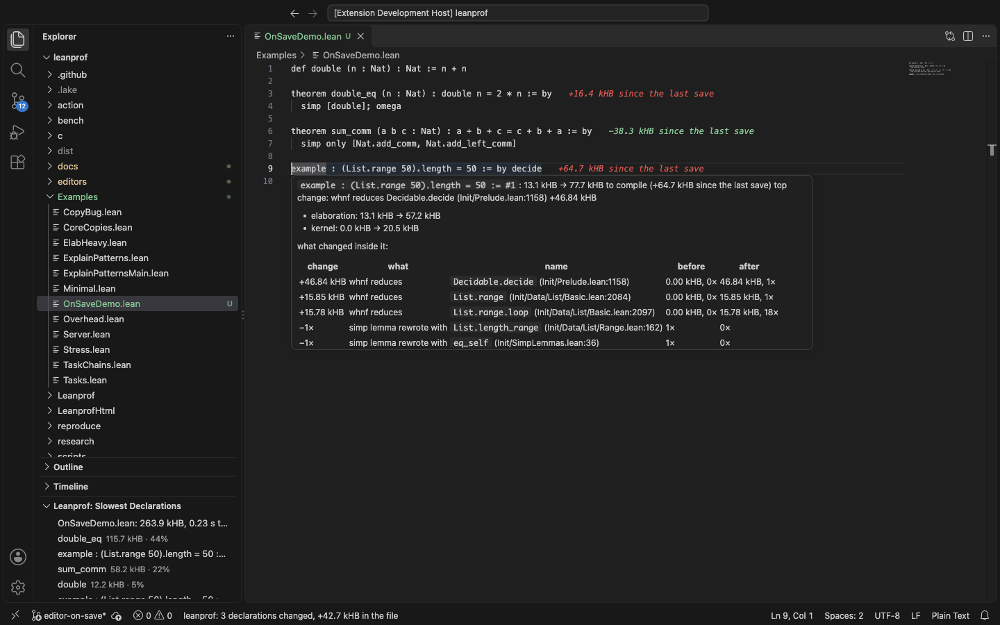

# VS Code extension

The extension in [`editors/vscode/`](../../editors/vscode) runs the
`leanprof` command from the command palette and shows what it writes in the
editor. It has no profiling logic of its own: every number comes from the
command, so the extension and the command line always agree.



## Install

1. Install the command ([getting started](getting-started.md#install-the-command)):

   ```
   curl -sSfL https://raw.githubusercontent.com/unbalancedparentheses/leanprof/main/scripts/install.sh | sh
   ```

2. Download `leanprof-X.Y.Z.vsix` from the
   [latest release](https://github.com/unbalancedparentheses/leanprof/releases/latest)
   and install it:

   ```
   code --install-extension leanprof-0.1.0.vsix
   ```

   or, in VS Code, **Extensions: Install from VSIX…** from the command
   palette. (The extension is not on the Marketplace.) Every CI run also
   keeps the `.vsix` of its commit as the `leanprof-vscode` artifact.

3. If VS Code does not see `leanprof` on its `PATH` (common when VS Code is
   started from the Dock or a desktop launcher), set **leanprof.path** to
   the full path, for example `~/.local/bin/leanprof`.

To build it yourself: `cd editors/vscode && npm ci && npm run package`.

## Commands

All are under **leanprof:** in the command palette, and run in the Lake
project of the open file (the nearest directory with a lakefile), or the
first workspace folder.

| command | runs | shows |
|---|---|---|
| **Run…** | `leanprof run [options] EXE -- ARGS` | the report in a terminal, then offers the HTML report |
| **Sample…** | `leanprof sample EXE -- ARGS` | the same for sampled CPU time; needs samply |
| **Compile cost of this file** | `leanprof elab --heartbeats FILE` | compile cost per line and declaration; also in the editor's context menu on `.lean` files |
| **Open report** | `leanprof html` | the [HTML report](html-report.md) (flame graph, tables, source, comparison) in a tab |
| **Live view** | `leanprof top --plain EXE -- ARGS` | the running program, refreshed: hot scopes, copies, allocations, tasks, waits |
| **Why is this file slow?** | `leanprof elab --heartbeats --since-last FILE` | the file's costliest declarations in a view ([below](#why-is-this-file-slow)) |
| (on save, opt-in) | `leanprof elab --since-last FILE`, `leanprof run --since-last EXE -- ARGS` | what changed since the last save, at the end of each line ([below](#on-save)) |

**Run…** asks for the executable (a `lean_exe` target) and its arguments,
as you would type them after `leanprof run`, then for options: `--auto`,
`--allocs`, `--counters`, `--frees`, `--core`, and `--trace`, which records
a timeline so that **Open report** shows the run's flame graph. The answers
are remembered per workspace.

**Open report** shows whatever reports are in `.lake/leanprof/` (the last
`run` or `sample`, and the last `elab`), the same page `leanprof html`
writes.

**Live view** stops the program when its tab is closed. It also takes
`--attach FILE` or `--pid PID` instead of an executable, for a program
already running with `LEANPROF_LIVE` ([live view](live.md)).



The hints of a whole report next to the code are not part of this
extension: add `#leanprof` to a file ([in the editor](editor.md)), which
works through the Lean extension's language server in any editor. What
changed on save is ([below](#on-save)).

## On save

With **leanprof.onSave.compileTime** on, saving a `.lean` file runs

```
leanprof elab --heartbeats --since-last FILE
```

in the background, which compares the file's compile cost with the previous
save ([what it writes](reference.md#difference-file)). Each declaration
whose heartbeats moved by more than 1,000 gets the change at the end of its
line: `+25.0 kHB since the last save` in the error color above
**leanprof.onSave.highlightAbove** (10 kHB), in the warning color below it,
in green for a decrease. Its hover says what changed inside the declaration,
from the same explanation `leanprof compare` gives a regression: the
definitions unfolded, instances tried and simp lemmas that rewrote, each
before and after, and the elaboration, kernel and compiler parts that
changed. Heartbeats barely vary between runs, so the change is the edit's.



With **leanprof.onSave.workload** set (`myapp -- input.txt`, as for
**Run…**), a save also runs `leanprof run --since-last` on it (or `stat`,
**leanprof.onSave.runCommand**) and shows the copy and allocation sites
whose counts changed at their lines: `+2,000 copies`. Counts are exact, so
any change is the edit's. The program is rebuilt with probes each time, so
this takes as long as a `leanprof run`.

A save waits **leanprof.onSave.delay** (500 ms) before it starts; another
save in that time starts the wait over, and one that arrives while a
profile runs stops it. The status bar shows the last result (`1 declaration
changed, +26.0 kHB in the file`); clicking it shows the log, with the
time each profile took. **leanprof: Forget the on-save profiles** starts
over (the next save is a first profile); **leanprof.onSave.keepBase**
compares every save with the first instead of the previous one.

How long a profile takes on save (`elab --since-last`, median of 3, Apple
M5 Max, shared):

| file | lines | heartbeats | plain `lean` | `elab --since-last` |
|---|---|---|---|---|
| MEASURED | | | | |

## Why is this file slow?

**leanprof: Why is this file slow?** (command palette, or the editor's
context menu) profiles the file now, as a save does, and opens the
**leanprof: slowest declarations** view in the explorer: the file's
declarations by compile cost, with their share of the file, the
elaboration, kernel, compiler and linter parts and the costliest operations
in the tooltip; clicking one goes to it. The file is elaborated as Lake
builds it (the package's options, through Lake's setup for the module),
which is also how the language server elaborates it, so the declarations
that cost the most here are those the server waits on when it re-elaborates
the file. The view follows the active file, and shows the last on-save
profile (or the last `leanprof elab`) of it.

## Settings

| setting | default | |
|---|---|---|
| `leanprof.path` | `leanprof` | the command: a name on `PATH` or a full path (`.lake/build/bin/leanprof` of a checkout works too) |
| `leanprof.liveInterval` | `500` | milliseconds between frames of the live view |
| `leanprof.onSave.compileTime` | off | profile a `.lean` file's compile time on save and show what changed |
| `leanprof.onSave.workload` | empty | a program to profile on save (`EXE -- ARGS`), for copies and allocations |
| `leanprof.onSave.runCommand` | `run` | `run` or `stat` for the workload |
| `leanprof.onSave.runOptions` | `["--allocs"]` | options of `run` or `stat` for the workload |
| `leanprof.onSave.delay` | `500` | milliseconds to wait after a save |
| `leanprof.onSave.highlightAbove` | `10` | kHB: larger increases in the error color |
| `leanprof.onSave.keepBase` | off | compare with the first on-save profile instead of the previous |

## Keybindings

A command given its target as an argument does not ask for it:

```json
[
  { "key": "ctrl+alt+r", "command": "leanprof.run",
    "args": { "target": "myapp -- input.txt", "options": ["--allocs", "--trace"] } },
  { "key": "ctrl+alt+s", "command": "leanprof.sample", "args": { "target": "myapp -- input.txt" } },
  { "key": "ctrl+alt+t", "command": "leanprof.live", "args": { "target": "server -- 8080" } }
]
```

## Development

`editors/vscode/extension.js` is the extension; `lib.js` holds what needs
no VS Code (reading the difference files and reports, one profile per file
at a time), with unit tests that run in plain Node. The other tests run the
commands in a real VS Code (downloaded by `@vscode/test-electron`) against
this repository, including two saves of a scratch file and of a workload:

```
lake build leanprof copybug server
cd editors/vscode && npm ci
npm run test:unit                 # lib.js, no VS Code
npm test                          # xvfb-run -a npm test on a Linux server
node media/screenshot.mjs         # the screenshots above, from that VS Code
```
